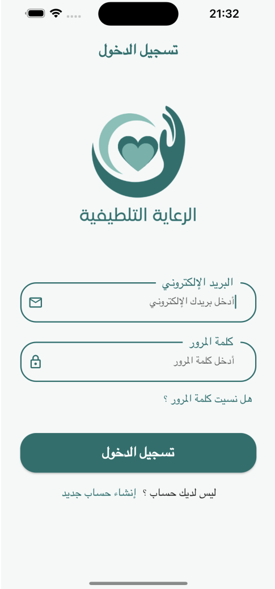
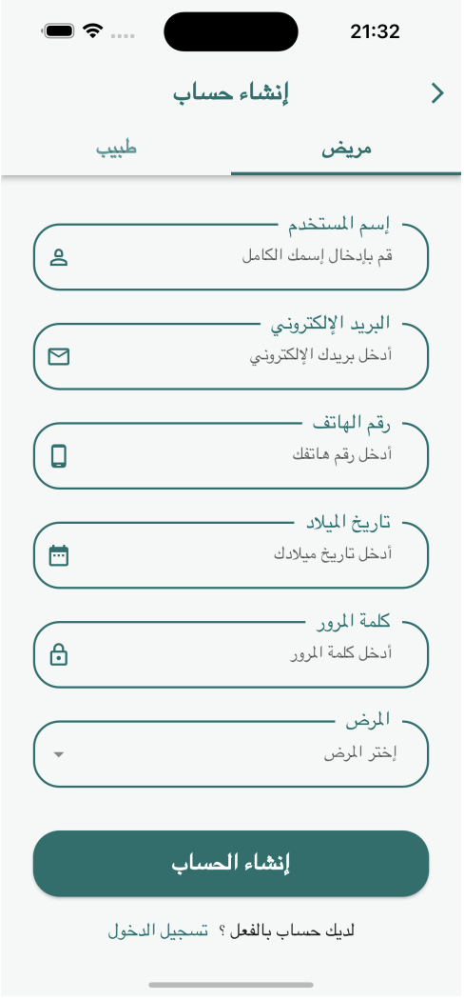
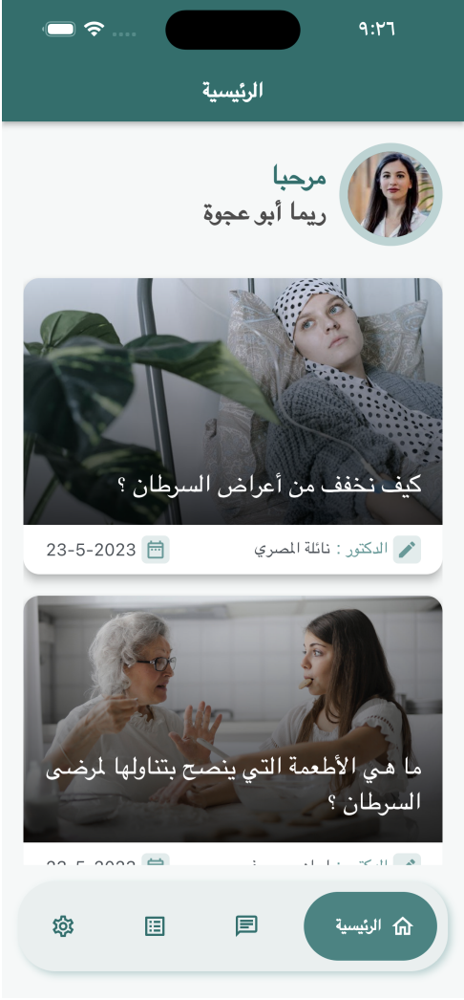
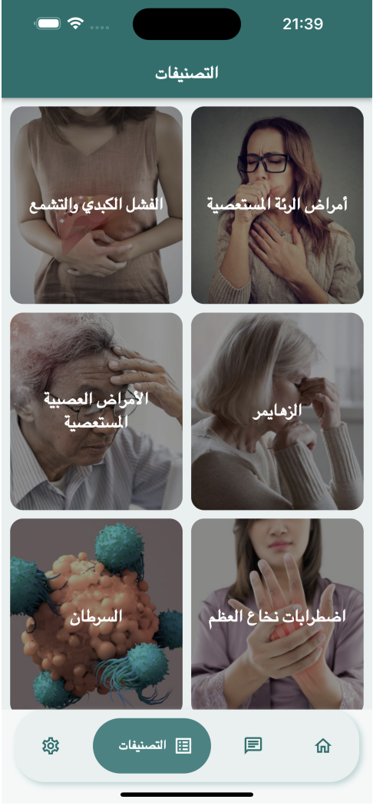
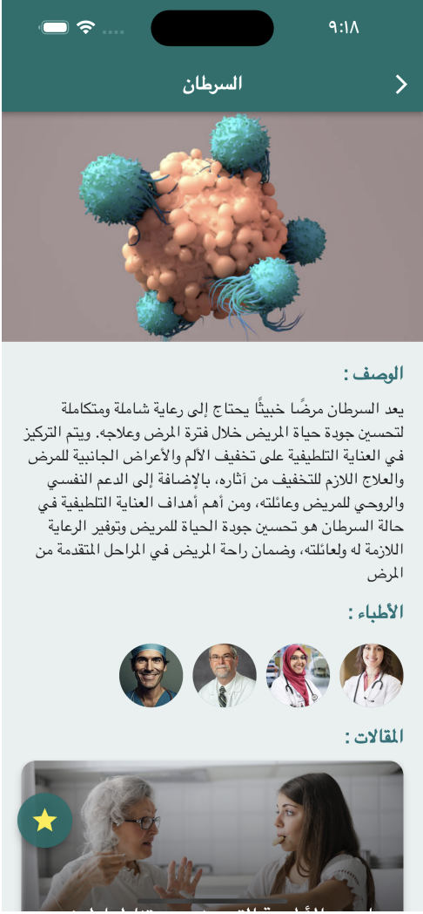
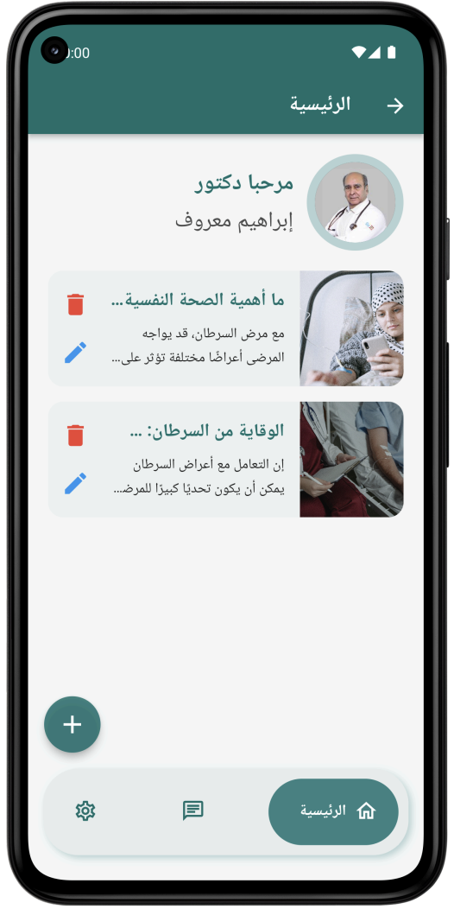
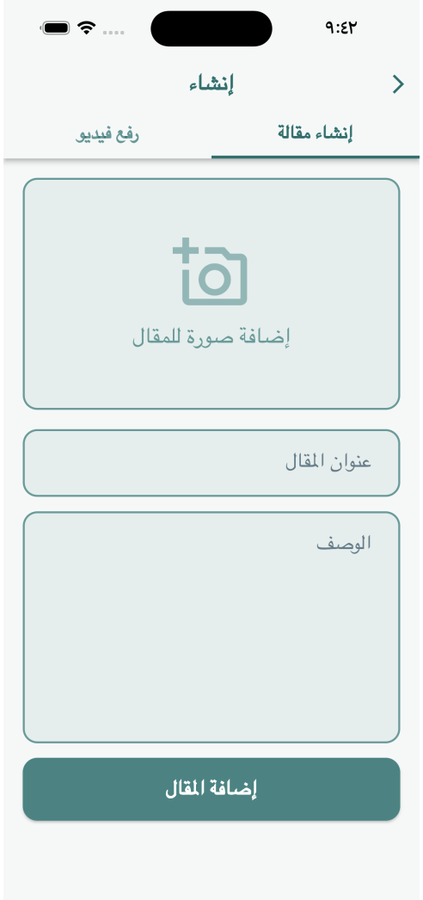
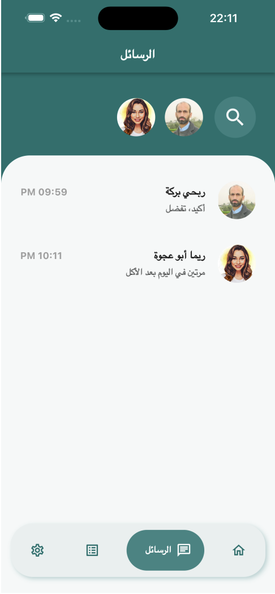
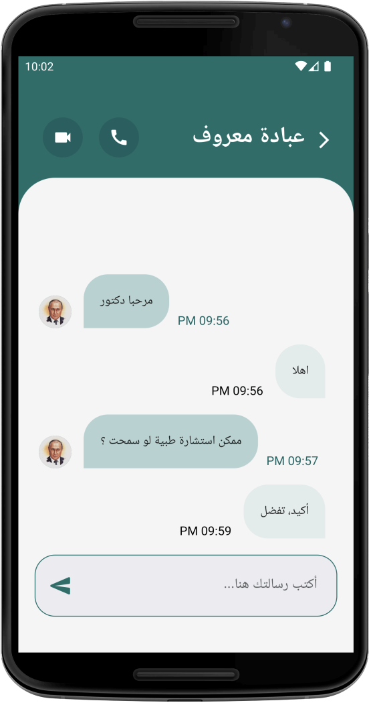
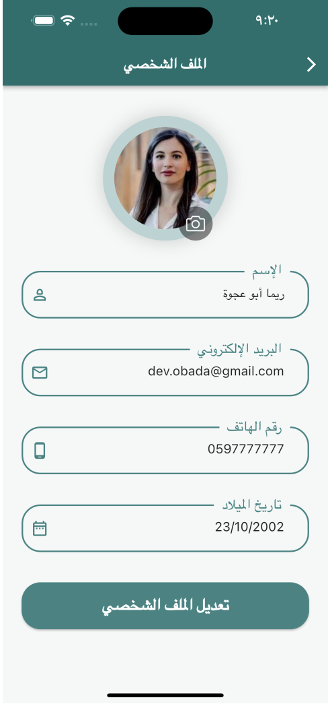

# <div align="center">

# 🏥 Palliative Care App | تطبيق الرعاية التلطيفية

### *Bridging the gap between chronic disease patients and specialized medical care*

[](https://flutter.dev)
[](https://dart.dev)
[](https://firebase.google.com)
[]()

<p align="center">
  A comprehensive, cross-platform healthcare application built with <b>Flutter</b> and <b>Firebase</b>, specifically designed to support patients requiring palliative care and chronic disease management through real-time consultations, medical articles, and educational video content.
</p>

</div>

---

## 🌟 Key Features

* 🔐 **Role-Based Access Control (RBAC):** Dedicated interfaces, permissions, and workflows tailored for both **Patients** and **Doctors**.
* 🧬 **Chronic Disease Hubs:** Specialized medical categories covering Cancer, Alzheimer's, Liver Failure, Lung Diseases, Bone Marrow Disorders, and Neurological conditions.
* 👨‍⚕️ **Doctor Dashboard & CMS:** Physicians can seamlessly publish, edit, and manage medical articles and educational videos directly from the app.
* 💬 **Real-Time Consultations:** Instant one-on-one chat messaging with voice and video call integration connecting patients with specialists.
* 🔔 **Smart Topic Subscriptions:** Patients can subscribe to specific disease categories to receive personalized updates and medical guidance.
* 🛡️ **Secure Authentication:** Complete account management with email verification and profile customization powered by Firebase Auth.

---

## 📱 Interactive UI Showcase

### 🩺 Patient Journey & Medical Hubs
<div align="center">
  <table>
    <tr>
      <td align="center"><b>🔐 Login</b><br><sub>Secure Access</sub></td>
      <td align="center"><b>📝 Registration</b><br><sub>Role Selection</sub></td>
      <td align="center"><b>🏠 Patient Home</b><br><sub>Main Feed</sub></td>
      <td align="center"><b>🧬 Categories</b><br><sub>Disease Hubs</sub></td>
      <td align="center"><b>📖 Disease Details</b><br><sub>Articles & Doctors</sub></td>
    </tr>
    <tr>
      <td></td>
      <td></td>
      <td></td>
      <td></td>
      <td></td>
    </tr>
  </table>
</div>

### 👨‍⚕️ Doctor Dashboard, Live Chat & Profile
<div align="center">
  <table>
    <tr>
      <td align="center"><b>👨‍⚕️ Doctor Home</b><br><sub>Content Manager</sub></td>
      <td align="center"><b>🎬 Create Content</b><br><sub>Upload Media</sub></td>
      <td align="center"><b>🔍 Messages</b><br><sub>Doctor Directory</sub></td>
      <td align="center"><b>💬 Live Chat</b><br><sub>Instant Consult</sub></td>
      <td align="center"><b>⚙️ User Profile</b><br><sub>Account Settings</sub></td>
    </tr>
    <tr>
      <td></td>
      <td></td>
      <td></td>
      <td></td>
      <td></td>
    </tr>
  </table>
</div>

<div align="center">
  <br>
  <a href="./screenshots">
    
  </a>
</div>

---

## 🛠️ Tech Stack & Architecture

* 🎨 **Frontend Framework:** Flutter & Dart
* ☁️ **Backend & Cloud Services:** Firebase Auth, Cloud Firestore, Firebase Storage
* 🏗️ **Architecture Pattern:** Clean MVC Modular Structure (`controller`, `model`, `view`, `firebase`)
* 📐 **Responsive Design:** Powered by `flutter_screenutil` for pixel-perfect adaptation across mobile and web viewports

```text
lib/
├── controller/   # Business logic & state management controllers
├── firebase/     # Authentication, Firestore CRUD & Storage services
├── model/        # Data models & JSON serialization entities
├── view/         # UI screens, dialogs & reusable custom widgets
└── main.dart     # Application entry point & theme configuration
```

---

## 🚀 Getting Started

1. **Clone the repository:**
   ```bash
   git clone https://github.com/dev-obadamarouf/palliative-care-app.git
   ```
2. **Navigate to the project directory:**
   ```bash
   cd palliative-care-app
   ```
3. **Install dependencies:**
   ```bash
   flutter pub get
   ```
4. **Run the application:**
   ```bash
   flutter run
   ```

---

## 👨‍💻 Author

**Obada Marouf (Ibrahim Saeed Marouf)**
* 🐙 **GitHub:** [@dev-obadamarouf](https://github.com/dev-obadamarouf
)
